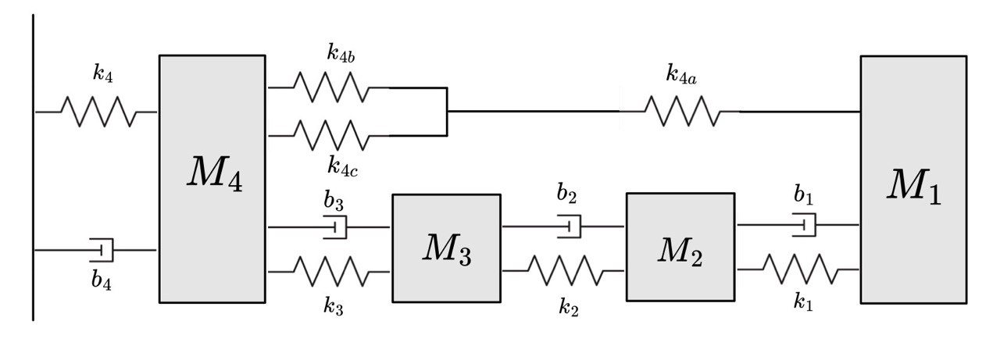

# Optimal and Robust Control of a MIMO System

This repository contains the design, implementation, and simulation of various advanced control strategies applied to a Multiple-Input Multiple-Output (MIMO) mechanical plant. The project demonstrates the step-by-step development of controllers aimed at ensuring precise position tracking, disturbance rejection, and robust stability.

## ⚙️ The Plant
The physical system under study consists of a coupled mechanical plant featuring 4 masses interconnected by a network of springs and dampers. 



The control objective is to accurately control the positions of two specific masses by applying independent control forces, managing a fully coupled MIMO dynamic system.

## 🛠️ Control Strategies Implemented
The project explores and compares four different control methodologies:
1. **Pole Placement (State Feedback) & Observer:** Implementation of a state-feedback controller with an integral action to ensure zero steady-state error, coupled with a Luenberger observer to estimate unmeasurable states.
2. **Linear Quadratic Regulator (LQR):** Design of an optimal state-feedback controller by tuning state and control effort weighting matrices ($Q$ and $R$) to achieve a fast and smooth transient response.
3. **Linear Quadratic Gaussian (LQG):** Integration of the LQR with a **Kalman Filter** to handle process and measurement noise (modeled as white Gaussian noise), optimizing the state estimation in a stochastic environment.
4. **$H_\infty$ Control (Mixed Sensitivity Design):** Synthesis of a robust controller aiming to minimize the $H_\infty$ norm of the closed-loop system, carefully shaping the sensitivity $S(s)$ and complementary sensitivity $T(s)$ weighting functions ($W_s, W_t, W_k$) to guarantee robustness against uncertainties and high-frequency noise.

## 🚀 How to Use / Run the Project
To run the simulations and generate the comparison plots:
1. **Prerequisites:** Ensure you have **MATLAB** and **Simulink** installed, along with the *Control System Toolbox* and *Robust Control Toolbox*.
2. **Clone the repository:**
   ```bash
   git clone https://github.com/danieffe/Optimal-and-Robust-Control-of-a-MIMO-System.git
    ```
3. **Open MATLAB:** Navigate to the cloned folder.
4. **Run the Live Script:** Open `Tesina_controlli.mlx`. You can run it section by section to understand the mathematical synthesis, or simply click **Run All** in the Live Editor tab.
5. **Results:** The script will automatically load the workspace parameters, execute the respective `.slx` Simulink models in the background, and output all the step response and control effort plots directly inline.


